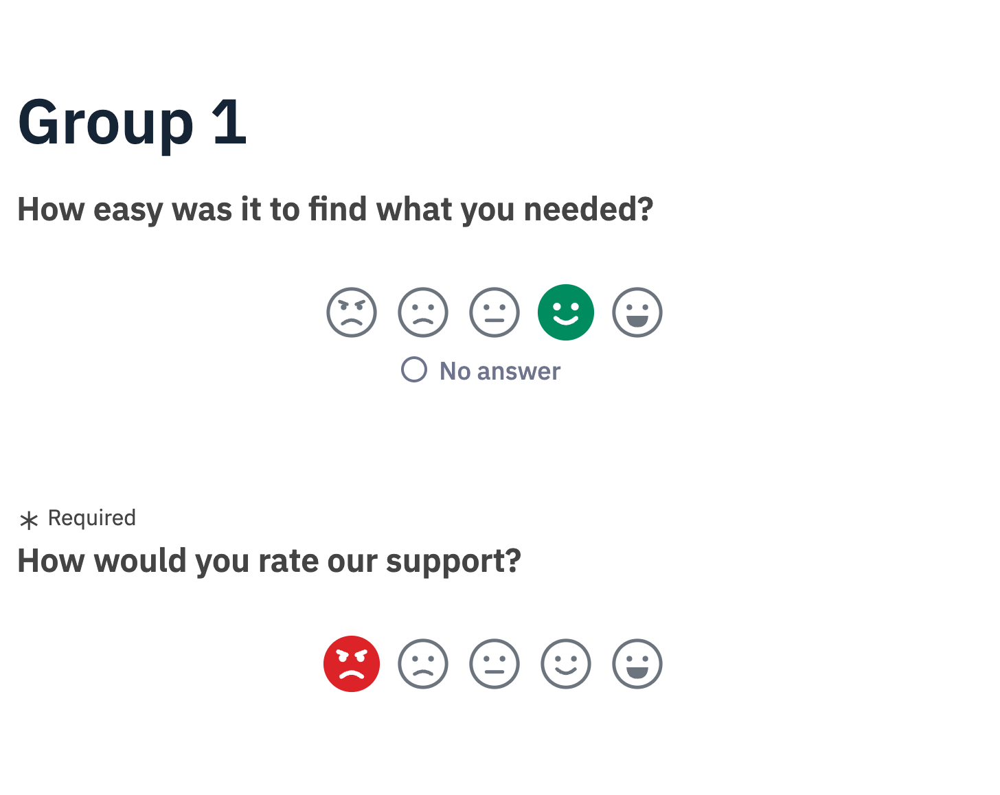

# 5 Point Smileys Text — LimeSurvey question theme

A question theme for the **5 point choice** question type: the answers are five faces, from angry to happy.
The faces are vector icons inside the stylesheet, so there are no images or web fonts to load,
they stay sharp at any size, and colours are plain CSS.



- Five faces; the selected one is filled with its colour (red, orange, blue, green, green by default).
- "No answer" for optional questions stays a normal radio button under the faces.
- Real radio buttons underneath: keyboard (Tab, arrow keys), screen readers ("1"…"5"), visible focus ring,
  Windows high contrast mode, reduced motion.
- Responses are stored as usual (1–5), conditions and expressions work as with the core question.
- Every style is scoped to the question: other questions on the page keep their look.
- Works with the LimeSurvey survey themes Fruity TwentyThree, Fruity and Vanilla, desktop and mobile.

## Requirements

LimeSurvey 6 or 7 (tested on 6.17, 7.5 and 7.10).

## Installation

1. Download `5-Point-Smileys-Text-<version>.zip` from [Releases](https://github.com/saginsa/limesurvey-5-point-smileys-text/releases).
2. In LimeSurvey: **Configuration → Themes → Question themes → Upload & install**, choose the zip.

Or copy this repository's `survey/` folder to `upload/themes/question/5-Point-Smileys-Text/` on the server
and press **Install** on the question themes page.

Uploading a newer zip replaces the installed version; questions keep using the theme.

## Usage

Create a question of type **5 point choice** and pick **5 Point Smileys Text** as its question theme
(in the question type selector, or in the question's *Display* settings).

## Customisation

Override the CSS variables in your survey theme (**Theme options → Custom CSS**, or `custom.css`):

```css
.smiley-list {
    --smiley-size: 3rem;            /* face size, 2.5rem by default */
    --smiley-gap: 1rem;             /* space between faces */
    --smiley-idle-color: #6c757d;   /* faces that are not selected */
    --smiley-hover-color: #343a40;
    --smiley-focus-color: #0d6efd;  /* keyboard focus ring */
    --smiley-color-1: #dc2328;      /* selected face 1 (angry) … */
    --smiley-color-2: #ff6e0a;
    --smiley-color-3: #e0a800;
    --smiley-color-4: #7cb342;
    --smiley-color-5: #2e9d4f;      /* … selected face 5 (happy) */
}
```

The icons are variables too (`--smiley-icon-1` … `--smiley-icon-5` and `--smiley-icon-N-selected`), so they can be
replaced by your own SVGs. In this repository they are generated from [`tools/icons`](tools/icons) by
`tools/build-css.py`.

## Upgrading from 1.0

Version 1.0 used an embedded third-party icon font. 2.0.0 draws its own SVG icons and fixes a few problems
(see [CHANGELOG](CHANGELOG.md)): it no longer changes radio buttons of other questions, shows "No answer",
works with the keyboard and screen readers. The theme name is the same, so uploading the new zip updates
the questions that already use it.

## Development

```sh
tests/static.sh                 # config.xml, templates, stylesheet, icons, secrets, spelling
tests/integration/run.sh        # LimeSurvey + MySQL in Docker: install the zip, render, answer, update
tools/build-zip.sh              # dist/5-Point-Smileys-Text-<version>.zip
```

`run.sh` takes `LS_TAG=6.17.19+260832` (a LimeSurvey tag on GitHub, 7.5.1 by default), `LS_TARBALL=<file>`
and `KEEP=1` (leave the containers running on <http://localhost:8098/index.php/admin>, user `admin`,
password `Smileys-test-2026`).

## License

GNU General Public License version 2 or later, see [LICENSE.txt](LICENSE.txt).

Based on the question themes "5 Point Emojis" and "5 Point Smileys" by Tony Partner,
<https://github.com/tpartner/LimeSurvey-5-Point-Emojis>, published under this license:

> MIT License
>
> Copyright (c) 2019 Tony Partner
>
> Permission is hereby granted, free of charge, to any person obtaining a copy of this software and associated
> documentation files (the "Software"), to deal in the Software without restriction, including without limitation
> the rights to use, copy, modify, merge, publish, distribute, sublicense, and/or sell copies of the Software, and to
> permit persons to whom the Software is furnished to do so, subject to the following conditions:
>
> The above copyright notice and this permission notice shall be included in all copies or substantial portions of
> the Software.
>
> THE SOFTWARE IS PROVIDED "AS IS", WITHOUT WARRANTY OF ANY KIND, EXPRESS OR IMPLIED, INCLUDING BUT NOT LIMITED TO THE
> WARRANTIES OF MERCHANTABILITY, FITNESS FOR A PARTICULAR PURPOSE AND NONINFRINGEMENT. IN NO EVENT SHALL THE AUTHORS OR
> COPYRIGHT HOLDERS BE LIABLE FOR ANY CLAIM, DAMAGES OR OTHER LIABILITY, WHETHER IN AN ACTION OF CONTRACT, TORT OR
> OTHERWISE, ARISING FROM, OUT OF OR IN CONNECTION WITH THE SOFTWARE OR THE USE OR OTHER DEALINGS IN THE SOFTWARE.

The templates follow the core `5pointchoice` templates of [LimeSurvey](https://github.com/LimeSurvey/LimeSurvey) (GPL v2 or later).
